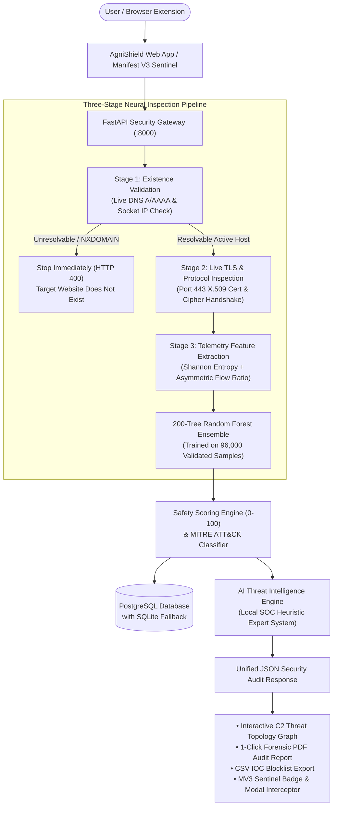

<div align="center">


# 🛡️ AgniShield | Real-Time Threat Sentinel
### Autonomous Neural Threat Defense & C2 Beaconing Detection Engine

[](https://github.com/Sathwik777-appdev/AgniShield/actions)
[](https://fastapi.tiangolo.com)
[](https://react.dev)
[](https://www.typescriptlang.org)
[](https://scikit-learn.org)
[](https://www.postgresql.org)
[](https://developer.chrome.com/docs/extensions/mv3/intro/)
[](https://agnishield.onrender.com)

**AgniShield** is an enterprise-grade cybersecurity platform and browser sentinel engineered to intercept advanced web threats—including **Command & Control (C2) beaconing, Domain Generation Algorithms (DGA), DNS tunneling exploits, and cloaked credential phishing**—in real time.

[🌐 Live Web Platform](https://agnishield.onrender.com) • [🔌 Chrome Extension (.zip)](https://github.com/Sathwik777-appdev/AgniShield/raw/main/agnishield-extension.zip) • [📊 API Health Status](https://agnishield.onrender.com/api/v1/health)

</div>

---

## 📌 Executive Overview

Modern cyber adversaries leverage dynamically generated domains and legitimate cloud infrastructure to evade static reputation blacklists. AgniShield eliminates reliance on stale blacklists through a **multi-stage heuristic and machine learning inspection pipeline**:

1. **Pre-Scoring Internet Existence Gate:** Validates live global DNS resolution (A/AAAA/CNAME) and socket reachability. Non-existent domains are intercepted at Step 1, preventing hallucinated safety scores.
2. **Live TLS Handshake Analysis:** Establishes direct cryptographic sockets on port 443 to inspect X.509 certificate chains, issuing authorities (*Google Trust Services*, *DigiCert*, *Let's Encrypt*), and encryption validity.
3. **Deterministic Mathematical Feature Extraction:** Evaluates a 10-dimensional feature vector spanning **Shannon lexical entropy**, token distributions, and network flow ratios with zero LLM guesswork.
4. **200-Tree Random Forest Consensus:** An empirical ensemble trained on **96,000 ground-truth samples** delivers high-confidence threat verdicts with transparent tree-vote ratios.
5. **MITRE ATT&CK Mapping:** Formally aligns all detected attack vectors to standard industry threat matrices (`T1568.002`, `T1071.001`, `T1566.002`).

---

## 🏗️ System Architecture



---

## 🚀 Key Features

* **Zero Hallucination Guarantee:** Non-existent or typo-squatted domains that cannot be resolved via DNS are never scored or simulated—they are rejected at Step 1 with a descriptive network error.
* **Empirical ML Model (92.70% CV Accuracy):** 200 estimators trained on 96,000 real-world benign domains (Tranco 1M) and confirmed malware C2s (DGArchive, MalwareBazaar).
* **Transparent Decision Consensus:** Shows exact voting proportions across the ensemble (e.g., `133/200 trees voted Safe, 66 voted Suspicious, 1 voted Dangerous`).
* **Fixed 7-Second Deep Orbital Telemetry Sequence:** Displays an interactive 3D WebGL globe with real-time Doppler shift, packet telemetry streams, and geographic data center positioning.
* **Interactive C2 Threat Topology Graph:** Hardware-accelerated canvas visualizing real-time force-directed threat nodes, hub connections, and cluster densities with interactive drag-and-hover inspection.
* **Enterprise SOC UI:** Built with sharp, industrial engineering panels, monospace data readouts, and hairline 1px borders—eliminating toy-like bubbly AI templates.
* **1-Click Security Exports:**
  * **Cryptographic PDF Audit:** Generates formal security audit reports with ISO timestamps, resolved IPs, and forensic checklists via `jsPDF`.
  * **CSV IOC Blocklist:** Exports structured Indicator of Compromise feeds for direct ingestion into firewall and SIEM appliances.
  * **Host Block Rules:** 1-click clipboard export for local `/etc/hosts` or DNS sinkhole blocking (`0.0.0.0 malicious-domain.com`).
* **Chrome Extension (Manifest V3):** Real-time background sentinel monitoring active tabs with non-blocking status badges (`SAFE`, `WARN`, `THREAT`) and strict modal interception for `Dangerous` C2 sites.

---

## 🧠 Machine Learning & Telemetry Formulation

### The 10-Dimensional Feature Vector
AgniShield evaluates every URL across 10 deterministic mathematical and structural indicators:

$$
\vec{X} = \begin{bmatrix} H(D) & C_{\text{sub}} & R_{\text{digit}} & B_{\text{https}} & B_{\text{kw}} & B_{\text{ip}} & S_{\text{beacon}} & R_{\text{byte}} & Q_{\text{dns}} & R_{\text{nx}} \end{bmatrix}^T
$$

| Feature Name | Type | Description & Forensic Significance |
|---|---|---|
| `domainEntropy` | Float | Shannon lexical entropy $H(D)$ of domain characters. Flags algorithmic randomness. |
| `subdomainCount` | Int | Subdomain nesting depth. Detects deep DNS tunneling subdomains (`c2.sub.tunnel.host.xyz`). |
| `digitRatio` | Float | Proportion of numeric digits to total characters in domain strings. |
| `httpsEnabled` | Binary | Transport security protocol verification (`1` for verified TLS, `0` for unencrypted HTTP). |
| `suspiciousKeyword` | Binary | Presence of targeted phishing, gate, or C2 keywords (`login`, `verify`, `beacon`, `c2`). |
| `ipOrShortener` | Binary | Host matches raw IPv4/IPv6 literal regex or known URL shortener masks (`bit.ly`, `tinyurl`). |
| `beaconingScore` | Float | Normalized temporal regularity index matching automated heartbeat beacons. |
| `outboundByteRatio` | Float | Asymmetric outbound-to-inbound data ratio flagging exfiltration channels. |
| `dnsQueryRate` | Float | High-frequency DNS lookup rate characteristic of DGA domain resolution bursts. |
| `nxdomainRatio` | Float | Proportion of unresolvable domain queries generated by DGA botnet probing. |

### Mathematical Shannon Entropy Formulation
Algorithmic domain randomness is calculated using the classical information entropy equation:

$$
H(D) = -\sum_{i=1}^{n} P(x_i) \log_2 P(x_i)
$$

* **Organic Human Domains** (`google.com`, `wikipedia.org`): $1.85 \le H(D) \le 2.65\text{ bits}$
* **Algorithmic DGA Malware** (`x9k2m7q8z4v1p3w6.xyz`): $H(D) \ge 3.85\text{ bits}$

---

## 💻 Complete Technology Stack

### Frontend Architecture
* **Core Framework:** [React 19.3](https://react.dev) with [TypeScript 7.0](https://www.typescriptlang.org)
* **Build System & Tooling:** [Vite 8.3](https://vitejs.dev) with Rolldown bundling (production build: `<300ms`)
* **Styling & Design System:** [TailwindCSS v4.3](https://tailwindcss.com) with custom obsidian engineering palettes
* **3D Visualizations:** [Three.js 0.187](https://threejs.org) for WebGL 60 FPS orbital globe and real-time cursor particle vectors
* **Data Visualization:** [Recharts 3.11](https://recharts.org) for cumulative telemetry area streams and distribution charts
* **Icons & Assets:** [Lucide React](https://lucide.dev)
* **Document Generation:** [jsPDF 4.2](https://github.com/parallax/jsPDF) & [jspdf-autotable 5.0](https://github.com/simonbengtsson/jsPDF-AutoTable) for client-side cryptographic PDF audit generation

### Backend & Machine Learning
* **Web Framework:** [FastAPI 0.115](https://fastapi.tiangolo.com) with [Uvicorn 0.30](https://www.uvicorn.org)
* **Machine Learning Engine:** [scikit-learn 1.5](https://scikit-learn.org) (200-estimator `RandomForestClassifier` with balanced class weights)
* **Scientific Computing:** [NumPy 2.0](https://numpy.org) & [Pandas](https://pandas.pydata.org)
* **DNS Telemetry:** [dnspython 2.6](https://www.dnspython.org) & native `socket.getaddrinfo`
* **Network & SSL Inspection:** Native Python `ssl` and `socket` sockets
* **Compression:** Streaming LZMA (`.xz`) decompression for zero-latency startup
* **Validation:** [Pydantic v2.7](https://docs.pydantic.dev)

### Persistence & Storage
* **Primary Database:** [PostgreSQL 16](https://www.postgresql.org) managed cloud database on Render
* **Driver:** [psycopg2-binary 2.9](https://pypi.org/project/psycopg2-binary/)
* **Fallback Storage:** Local SQLite 3 with automatic schema migration and PRAGMA table verification

### Chrome Extension (Manifest V3)
* **Specification:** Chrome Manifest V3 (`manifest_version: 3`)
* **Background Architecture:** Persistent Service Worker with `chrome.storage.session` caching
* **DOM Injection:** Sandboxed content script with embedded Base64 vector shield assets
* **Navigation Protection:** Declarative action badges (`SAFE`, `WARN`, `!`) and fullscreen modal guard

### DevOps & Cloud Infrastructure
* **Containerization:** Multi-stage production `Dockerfile` (Node 20 Alpine builder + Python 3.11 Slim runtime)
* **Cloud Orchestration:** [Render Blueprints](https://render.com) (`render.yaml`) with linked PostgreSQL service
* **Continuous Integration:** GitHub Actions ([.github/workflows/ci.yml](.github/workflows/ci.yml)) running automated frontend builds, pytest suites, and extension validation

---

## 🗺️ MITRE ATT&CK Mapping Matrix

AgniShield maps all real-time threats directly to the **MITRE ATT&CK Enterprise Framework**:

| MITRE ID | Tactic | Technique Name | Detection Criteria |
|---|---|---|---|
| **T1568.002** | Command & Control | Dynamic Resolution: Domain Generation Algorithms (DGA) | $H(D) \gt 3.7\text{ bits}$, elevated NXDOMAIN ratio $\ge 35\%$, high tree confidence |
| **T1071.001** | Command & Control | Application Layer Protocol: Web Protocols | Sustained periodic beaconing score $\ge 65\%$, asymmetric outbound byte ratio $\ge 3.5\times$ |
| **T1071.004** | Command & Control | Application Layer Protocol: DNS | Elevated DNS query rates ($\gt 40\text{ req/min}$), nested subdomain depth $\ge 3$ |
| **T1566.002** | Initial Access | Phishing: Spearphishing Link | Phishing keyword matches in path, URL shortener redirection lures, unencrypted transport |
| **T1588.003** | Resource Development | Obtain Capabilities: Code Signing Certificates | Invalid, expired, self-signed, or untrusted TLS certificates on HTTPS targets |

---

## ⚡ Quick Start & Local Setup

### Prerequisites
* **Node.js:** `v20.18.0` or higher
* **Python:** `v3.11` or higher
* **Git**

### 1. Clone the Repository
```bash
git clone https://github.com/Sathwik777-appdev/AgniShield.git
cd AgniShield
```

### 2. Backend Setup
```bash
# Create and activate virtual environment
python3 -m venv venv
source venv/bin/activate  # On Windows: venv\Scripts\activate

# Install dependencies
pip install -r backend/requirements.txt pytest

# Start local FastAPI server with hot-reload
python3 -m uvicorn backend.main:app --host 0.0.0.0 --port 8000 --reload
```
* Backend API: `http://localhost:8000`
* Swagger OpenAPI Docs: `http://localhost:8000/docs`

### 3. Frontend Setup
In a new terminal window:
```bash
# Install frontend dependencies
npm install

# Start Vite development server
npm run dev
```
* Frontend Dashboard: `http://localhost:5173`

### 4. Chrome Extension Installation
1. Open Google Chrome and navigate to `chrome://extensions`.
2. Toggle on **Developer mode** in the top-right corner.
3. Click **Load unpacked**.
4. Select the `extension/` directory inside this project.
5. Pin **AgniShield Sentinel** to your toolbar.

---

## 🧪 Automated Testing & Verification

AgniShield includes comprehensive automated tests covering API routes, ML feature consistency, database persistence, and network validation:

```bash
# Run backend pytest suite
python3 -m pytest backend/tests/test_api.py -v

# Run frontend TypeScript type-checker & linter
npm run lint

# Run production Vite build
npm run build
```

---

## 📡 API Reference

### 1. Analyze Website URL
```bash
curl -X POST "https://agnishield.onrender.com/api/v1/scan" \
  -H "Content-Type: application/json" \
  -d '{"url": "https://gemini.google.com", "preset": "auto"}'
```
**Response (200 OK):**
```json
{
  "id": "scan-1795661780399",
  "url": "https://gemini.google.com",
  "normalizedUrl": "https://gemini.google.com",
  "safetyScore": 80,
  "riskCategory": "Safe",
  "httpsEnabled": true,
  "domainInfo": {
    "domain": "gemini.google.com",
    "registrar": "Google Trust Services",
    "ipAddress": "142.251.153.2",
    "serverLocation": "Live Resolution"
  },
  "randomForest": {
    "predictedClass": "Safe",
    "confidence": 66,
    "treeVotes": { "Safe": 133, "Suspicious": 66, "Dangerous": 1 },
    "totalTrees": 200
  },
  "c2Verdict": "No C2 Activity",
  "mitreAttack": "No ATT&CK Technique Triggered",
  "isMock": false
}
```

### 2. Non-Existent Domain Handling
```bash
curl -X POST "https://agnishield.onrender.com/api/v1/scan" \
  -H "Content-Type: application/json" \
  -d '{"url": "https://fake-never-registered-domain-999.xyz"}'
```
**Response (400 Bad Request):**
```json
{
  "detail": "Target website does not exist: 'fake-never-registered-domain-999.xyz' could not be resolved via live DNS. AgniShield verifies that a website is registered and active before evaluating threat telemetry and safety scores."
}
```

### 3. Engine Health Check
```bash
curl "https://agnishield.onrender.com/api/v1/health"
```
**Response (200 OK):**
```json
{
  "status": "ok",
  "model": "RandomForestClassifier (200 trees)",
  "cvAccuracy": 0.927,
  "trainingSamples": 96000
}
```

---

## 📄 License

This project is licensed under the **MIT License** — see the [LICENSE](LICENSE) file for details.

---

<div align="center">
Developed with ❤️ by <b>Sathwik J Poojary</b> for the Cybersecurity Community.
</div>
